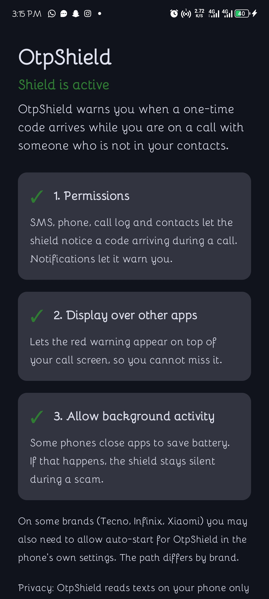
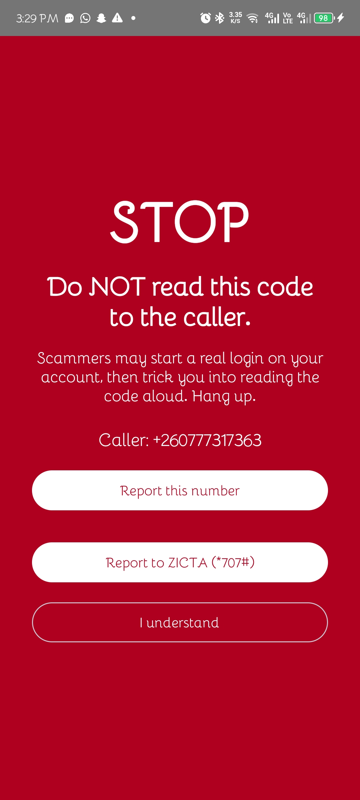
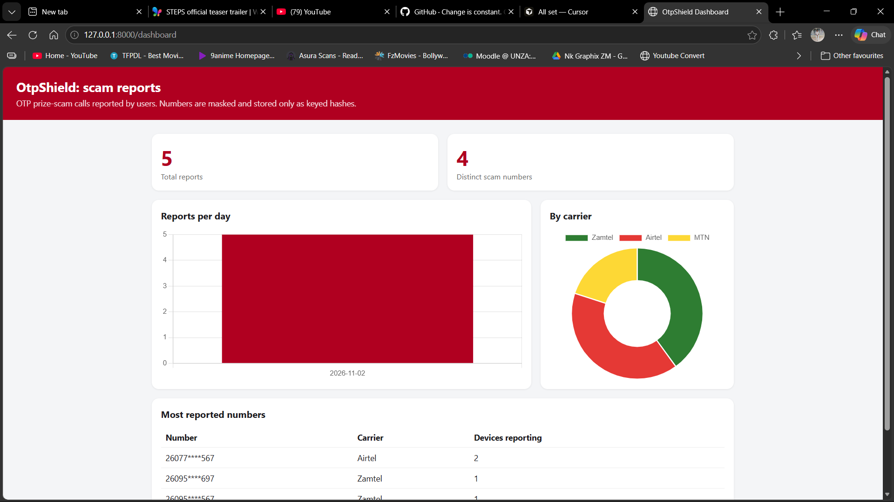
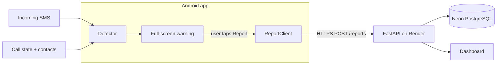

# OtpShield

An Android app that warns you in real time when a one-time code (OTP) arrives while you are on a call with someone who is not in your contacts: the pattern behind the "you've won a prize, read me the code" scam.

> Personal project. Not affiliated with ZICTA, any mobile operator or any bank. The "Report to ZICTA" button only opens the phone dialer with `*707#` filled in. The user decides whether to call.

## Screenshots

<!-- Add your own images to docs/images/ with these names. Use a test number, never a real caller's. -->
| Setup checklist | Warning screen | Dashboard (sample data) |
|---|---|---|
|  |  |  |

## The problem

Recently, I received a call from a Zamtel number. The caller used a "prize" story and asked me to read back an SMS code. They had triggered a genuine verification OTP to my phone, which made the story look credible. Because I understand how OTPs work, I refused, hung up, and reported the number to ZICTA via `*707#`.

This attack doesn't break into the carrier's network. The scammer starts a real login, PIN reset, or account recovery using the victim's number, then uses a phone call to talk the victim into handing over the code. The weakest link is the human, not the cryptography.

Many people, especially mobile money users who don't know how OTPs work, don't realise that the code is the key to their account. A real OTP arriving mid-call feels like proof that the caller is legitimate. Nothing warns the user at the moment it happens. OtpShield is that warning.

## How it works

1. An SMS arrives. `OtpDetector` looks for a 4-8 digit code plus a keyword such as "OTP", "code" or "PIN". This happens on the phone, and message text never leaves it.
2. The app asks Android whether a call is active right now, and whether the caller is in the phone's contacts.
3. If a code arrives during a call with an unknown number, a full-screen red warning appears over the call screen: **Do NOT read this code to the caller.**
4. The user can tap **Report this number**, or open the ZICTA `*707#` reporting line from the same screen.
5. Reports feed a small backend and a dashboard showing reports per day, per carrier, and the most reported numbers.

## Architecture



| Part | Tech |
|---|---|
| Android app | Kotlin, Jetpack Compose, `BroadcastReceiver`s for SMS and call state |
| API | Python, FastAPI, hosted on Render (free tier) |
| Database | PostgreSQL on Neon |
| Dashboard | HTML + Chart.js, served by the API, password-protected |

### API

| Endpoint | Access | Purpose |
|---|---|---|
| `GET /health` | public | Liveness check |
| `POST /reports` | public, rate-limited | Record a reported number |
| `GET /lookup?number=...` | public, rate-limited | Status of a number: unknown, reported or suspected |
| `GET /stats` | password | Aggregate data for the dashboard |
| `GET /dashboard` | password | The dashboard page |

## Privacy decisions

- Message text is read on the device only and is never sent anywhere.
- A number is sent to the server only when the user taps **Report**.
- Reported numbers are stored as HMAC-SHA256 hashes using a secret key held only on the server. A plain hash of a phone number would be easy to reverse because there are so few possible numbers.
- A masked version (like `26077****363`) is kept for the dashboard. The full number is never stored.
- Each install has a random ID that is not linked to the user. The server stores only a keyed hash of it, and allows one report per number per device per day.
- Public endpoints are rate-limited per IP address. The client IP is read from Cloudflare's header, because `X-Forwarded-For` can be forged on Render.
- The dashboard and stats are behind a password.

## Limitations

- Android only, installed as a sideloaded APK. Google Play restricts SMS and call-log permissions, so a Play release would need extra work.
- A spoofed caller ID that matches a saved contact will not trigger the warning.
- The detector was tested on real MTN, Zamtel, Airtel, TrustBank, Yellow Card and NAPSA messages. Other formats may be missed.
- Some phone brands (for example Tecno) stop background apps aggressively, so the user must allow background activity. The setup screen checks this.
- Rate-limit counters live in server memory and reset when the server restarts.
- The free Render server sleeps after 15 minutes without traffic, so the first request afterwards is slow.

## Project structure

```
otp-shield/
  app/        Android project (open this folder in Android Studio)
  backend/    FastAPI server, dashboard.html, requirements.txt
  docs/       spec and images
```

## Run it yourself

### Backend

Requires Python 3.10+ and a PostgreSQL database (a free Neon project works).

```powershell
cd backend
python -m venv .venv
.venv\Scripts\Activate.ps1
pip install -r requirements.txt

# generate a secret once and keep it safe: changing it breaks matching of old reports
python -c "import secrets; print(secrets.token_hex(32))"

$env:HMAC_SECRET = "<the generated secret>"
$env:DATABASE_URL = "<your PostgreSQL connection string>"
$env:ADMIN_PASSWORD = "<a strong password>"
uvicorn main:app --reload
```

Optional: `RATE_LIMIT` sets the maximum requests per IP per hour (default 30).

Open `http://127.0.0.1:8000/docs` to try the endpoints, and `/dashboard` for the dashboard (any username, your `ADMIN_PASSWORD`).

### Android app

1. Open the `app` folder in Android Studio and let Gradle sync. Minimum SDK is 26.
2. In `ReportClient.kt`, set `BASE_URL` to your server. For a local server over USB, run `adb reverse tcp:8000 tcp:8000`, use `http://127.0.0.1:8000`, and temporarily add `android:usesCleartextTraffic="true"` to the manifest's `<application>` tag. Remove it for anything deployed.
3. Run on a real phone. Emulators can fake SMS but behave differently for calls.
4. Complete the three items on the setup screen: permissions, display over other apps, and background activity. On Android 13+, a sideloaded app may also need **Settings > Apps > OtpShield > menu > Allow restricted settings** before the SMS permission can be granted.

### Tests

The detector has unit tests. In Android Studio, right-click `OtpDetectorTest` and choose **Run**.

### Deploy

On Render: a Web Service with root directory `backend`, build command `pip install -r requirements.txt`, start command `uvicorn main:app --host 0.0.0.0 --port $PORT`, and the three environment variables above.

## What I learned

- Real SMS messages differ from invented samples. Testing the detector against actual operator and bank messages was what made it trustworthy.
- A plain hash of a phone number is not anonymous. A keyed hash (HMAC) is the minimum.
- Android shows only a banner for full-screen alerts while the phone is in use. Forcing the warning over a live call needed the "display over other apps" permission.
- Asking Android for the live call state at the moment the SMS arrives is more reliable than remembering it, because some phones kill background apps.
- Behind a hosted proxy, the client IP header you trust decides whether your rate limiter works at all.
- Postgres is stricter than SQLite about `GROUP BY`, so moving databases surfaced queries that were quietly wrong.

## Roadmap

- Download a list of reported numbers to the phone, so the warning can say "this number was reported by N people" without sending call data to the server
- Smarter OTP detection that looks at where the code sits relative to the keyword
- More operator and bank message formats
- Safer handling of calls that arrive through WhatsApp and other apps

**AN ORIGINAL IDEA BY Mwewa NKandu**